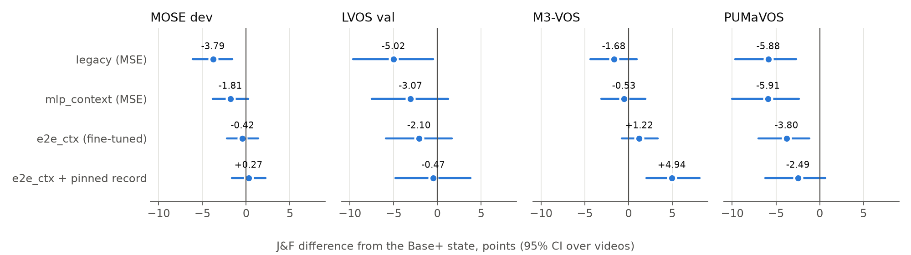

# test14 — Small → Base+ 전환 모델 설계 검토와 정확도 개선 실험

SAM 2.1 Small의 메모리를 Base+로 옮기는 전환 모델(Translator)의 설계를 점검하고 정확도를 높이는 실험의 코드, 결과, 가중치, 로그를 모았다. 실험 기간은 2026-11-04 ~ 11-05이고 RTX 4080 SUPER 2대를 사용했다.

전환이 필요한지와 언제 전환할지는 다루지 않는다. 전환이 이미 정해졌다고 보고 전환 모델의 J&F를 높이는 것이 목표다. Original+Last-Visible(OLV)과 Replay는 비교군이다.

## 결론

1. **세 설계(`residual_mlp`, `transformer`, `mlp_context`)의 구조에는 큰 문제가 없다.** 같은 파인튜닝을 거치면 세 구조의 차이는 네 데이터셋에서 모두 신뢰구간이 0을 포함한다.
2. **정확도를 가장 크게 제한한 것은 MSE 학습이다.** MSE는 조건부 평균을 내도록 학습시켜 메모리의 대비를 줄이고, 이 때문에 object score가 낮게 치우쳐 추적을 잃는다.
3. **Base+ memory attention과 mask decoder를 통과시키는 파인튜닝이 효과적이었다.** `legacy` 대비 MOSE dev +3.37, LVOS val +2.93, M3-VOS +2.90, PUMaVOS +2.08 [-0.09, +4.45]이다.
4. **권장 구성은 `mlp_context` + 선형 포인터 + 2라운드 파인튜닝(`e2e_ctx`)이다.** 파라미터는 276,672개이고, 대안은 더 단순한 `residual_mlp` 계열이다.
5. **3라운드 파인튜닝은 권장하지 않는다.** 외부 데이터셋에서 이득이 없었다(M3-VOS -0.14, PUMaVOS +0.39).
6. **논문 모델보다 뚜렷하게 좋다고 말하려면 기록 고정이 필요하다.** PUMaVOS 세 전환 시점 평균에서 `e2e_ctx`는 논문 Translator보다 +1.75 [-0.20, +3.94]로 불확실하고, 논문 보고 지점인 50%에서는 -0.67 [-4.43, +2.35]이다. 기록 고정을 더하면 +3.05 [+0.67, +5.63]이다. 기록 고정은 모델이 아니라 실행 정책의 변경이다.
7. **VOST는 실행하지 않았다.** 논문의 두 평가 데이터셋 중 하나는 비교하지 못했다.

## 결과 요약

J&F이며, 값은 영상 평균이다. 전환 뒤 객체가 보이는 프레임만 채점한다. PUMaVOS는 25/50/75% 세 전환 시점의 평균이고, M3-VOS는 50% 전환이다.

| 방법 | MOSE dev | LVOS val | M3-VOS | PUMaVOS |
|---|---:|---:|---:|---:|
| Base+ 실제 상태 | 64.58 | 75.84 | 60.80 | 74.23 |
| Small 유지 | 62.07 | 73.55 | 62.80 | 75.05 |
| `legacy` (MSE) | 60.79 | 70.82 | 59.10 | 68.38 |
| `mlp_context` (MSE) | 62.78 | 72.77 | 60.26 | 68.34 |
| `e2e_mlp` (2라운드) | 63.56 | 73.86 | 62.76 | 70.22 |
| `e2e_tf` (2라운드) | 63.46 | 74.04 | 61.52 | 70.77 |
| **`e2e_ctx` (2라운드, 권장)** | **64.17** | **73.74** | **62.00** | **70.46** |
| `e2e3_ctx` (3라운드) | 64.38 | 74.87 | 61.86 | 70.85 |
| `e2e_ctx` + 7프레임 기록 고정 | 64.85 | 75.37 | 65.73 | 71.76 |
| `e2e3_ctx` + 5프레임 기록 고정 | – | 75.73 | 66.01 | 72.29 |

영상 수는 MOSE dev 287, LVOS val 140, M3-VOS 81, PUMaVOS 24이다. `legacy`는 MOSE dev로 학습했고 LVOS val로 에폭을 골랐으므로, 두 데이터셋의 비교는 `legacy`에 유리한 조건이다.



## 논문과의 비교

**`legacy`는 논문 Translator가 아니다.** 논문 모델은 `r2` 학습의 에폭 26 가중치(SHA256 `6eb1ee0b…`)이고, `legacy`는 같은 구조로 따로 학습한 에폭 27 가중치(`92802842…`)이다. 그래서 PUMaVOS는 논문 평가 DB의 케이스별 점수와 직접 짝지어 비교했다. 같은 78개 케이스이고 전환 프레임과 채점 프레임 수가 모두 일치한다.

| 방법 (PUMaVOS) | 25% | 50% | 75% | 평균 | 논문 Translator 대비, 평균 |
|---|---:|---:|---:|---:|---:|
| Full Replay | 76.33 | 74.36 | 71.99 | 74.23 | – |
| Original+Last-Visible | 78.48 | 75.23 | 68.69 | 74.14 | – |
| 논문 Translator | 71.25 | 69.43 | 65.45 | 68.71 | – |
| `e2e_ctx` | 73.92 | 68.76 | 68.70 | 70.46 | +1.75 [-0.20, +3.94] |
| `e2e_ctx` + 7프레임 기록 고정 | 75.55 | 72.56 | 67.17 | 71.76 | +3.05 [+0.67, +5.63] |

자세한 내용은 [논문 비교](docs/04_paper_comparison.md)에 있다.

## 문서

| 문서 | 내용 |
|---|---|
| [01 실험 경과](docs/01_timeline.md) | 무엇을 왜 했고 판단이 어떻게 바뀌었는지 |
| [02 방법과 실행 목록](docs/02_catalog.md) | 방법 이름, 실행 태그, 모델, 산출물의 뜻 |
| [03 전체 결과](docs/03_results.md) | 단계별 결과 표 |
| [04 논문 비교](docs/04_paper_comparison.md) | 논문 수치 재현, 케이스별 비교, 비용 |
| [05 데이터 분리와 과적합](docs/05_data_separation.md) | 영상·장면 겹침, 학습 영상 효과 |
| [06 재현 방법](docs/06_reproduce.md) | 표를 다시 만드는 방법, 환경, 학습 명령 |
| [07 한계와 남은 일](docs/07_limits_and_open_items.md) | 알려진 한계, 결정할 항목, 미완료 실행 |

## 폴더 구조

```text
test14/
├── docs/                    문서
├── code/
│   ├── review/              서버에서 실행한 실험 코드 원본
│   ├── verify/              3개 모델 구성 검증 스크립트
│   └── analysis/            표와 그림 생성 스크립트
├── weights/                 학습된 가중치
│   ├── spatial/             공간 번역기 21개와 result.json
│   ├── pointer/             포인터 실험
│   └── ridge, moment, calib 닫힌 형식 해와 보정값
├── results/
│   ├── tables/              원자료에서 생성한 CSV
│   ├── figures/             그림
│   ├── reports/             실험 중 생성된 보고서
│   ├── analysis/            분석 산출물
│   ├── verify/              모델 구성 검증 결과
│   └── raw/                 케이스별 원자료 JSON (태그별 tar.gz)
├── logs/                    실행 기록과 전체 로그
├── data_manifest/           학습 데이터 목록과 해시
└── MANIFEST.sha256          이 폴더 전체 파일의 해시
```

권장 모델 가중치는 `weights/spatial/e2e_ctx_last/model.pt`이다. 실제 실행에는 `weights/ridge/ridge.pt`의 선형 포인터를 함께 쓴다.

## 올리지 않은 것

| 항목 | 크기 | 이유 | 대신 포함한 것 |
|---|---:|---:|---|
| 학습용 상태 쌍 메모리맵 `data/` | 334 GB | 저장소 용량 초과 | 파일별 SHA256, 케이스 목록 |
| 논문 평가 SQLite DB | 약 340 MB | `vos-memory-benchmark`의 기존 산출물 | 케이스별 점수 CSV |
| 프레임 이미지 3장 | 작음 | 데이터셋 프레임이 들어 있어 공개 저장소에 올리지 않음 | 장면 겹침 수치와 영상 쌍 목록 |
| `pylibs` | 324 MB | 외부 라이브러리 | 환경 설정 파일 |
| 데이터셋 원본과 SAM2 체크포인트 | – | 재배포 대상이 아님 | 경로 |
