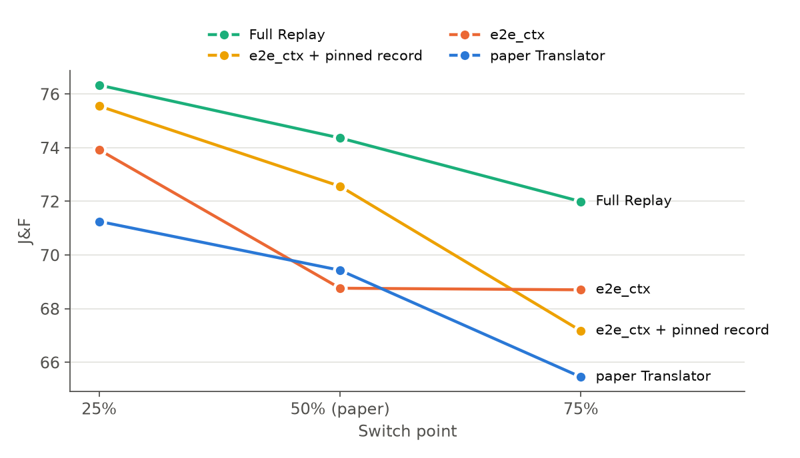
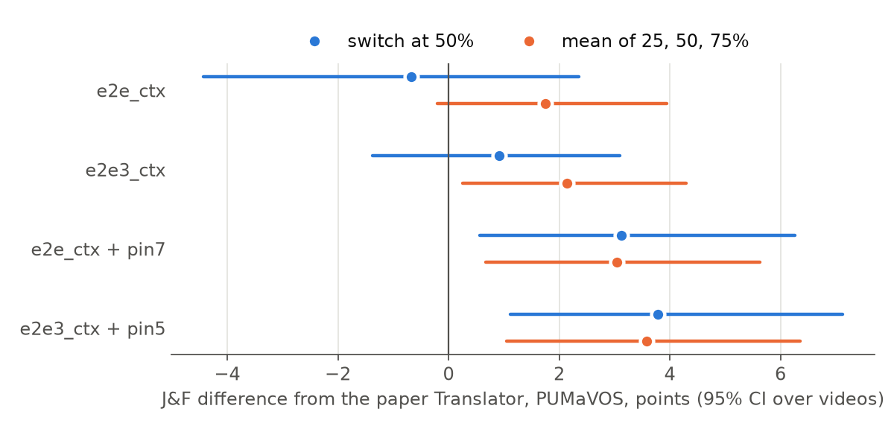

# 04 논문 비교

대상 논문은 「비디오 객체 분할에서 모델 간 메모리 상태 전달의 분할 품질과 전환 비용 분석」이다.

## 비교의 전제

### 논문 모델과 `legacy`는 다르다

| 항목 | 논문 Translator | `legacy` |
|---|---|---|
| 학습 | `r2` frozen split | 1차 공식 학습 |
| 선정 | validation R² Q=0.6190, 에폭 26 | LVOS val state loss 0.4926, 에폭 27 |
| 학습 기록 | 294,793개 | 323,857개 |
| 구조 | transformer + MLP, 457,216개 | 같음 |
| SHA256 | `6eb1ee0b99a20fcc…` | `92802842b0f9c224…` |

논문 평가 DB의 `translator_sha256`이 `r2` 가중치와 일치한다. PUMaVOS에서 `legacy`와 논문 모델의 차이는 50%에서 -0.26 [-1.26, +0.34]로 오차 범위 안이다. 그래도 아래 비교는 `legacy`를 대리값으로 쓰지 않고 논문 DB의 케이스별 점수와 직접 짝지었다.

### 논문 수치 재현

논문 DB에서 객체 → 영상 → 회차 순으로 다시 집계하면 PUMaVOS 50%의 그림 값이 나온다.

| 방법 | 논문 그림 | DB 재집계 |
|---|---:|---:|
| Source-only | 75.3 | 75.33 |
| Full Replay | 74.4 | 74.36 |
| Original+Last-Visible | 75.2 | 75.23 |
| Direct Copy | 0.0 | 0.01 |
| Translator | 69.4 | 69.43 |

### 두 평가기의 일치

PUMaVOS 78개 케이스(영상 24개, 객체 26개, 전환 25/50/75%)에서 전환 프레임과 채점 프레임 수가 78개 모두 같다. 같은 방법의 점수 차이는 다음과 같다.

| 방법 | 평균 차이 | 중앙값 차이 | 1점 이내 케이스 |
|---|---:|---:|---:|
| Source-only | +0.004 | +0.053 | 75/78 |
| Full Replay | -0.116 | +0.043 | 75/78 |
| Original+Last-Visible | +0.099 | +0.066 | 76/78 |
| Direct Copy | 0.000 | 0.000 | 78/78 |

GPU와 코드가 달라 케이스 단위로는 차이가 남지만(최대 8.93점), 평균은 사실상 같다. 그래서 PUMaVOS는 직접 비교할 수 있다.

## PUMaVOS 결과

| 방법 | 25% | 50% | 75% | 평균 |
|---|---:|---:|---:|---:|
| Source-only | 78.17 | 75.33 | 71.68 | 75.06 |
| Full Replay | 76.33 | 74.36 | 71.99 | 74.23 |
| Original+Last-Visible | 78.48 | 75.23 | 68.69 | 74.14 |
| Replay-8 | 71.27 | 70.01 | 66.84 | 69.37 |
| **논문 Translator** | 71.25 | 69.43 | 65.45 | 68.71 |
| `legacy` | 70.62 | 69.17 | 65.34 | 68.38 |
| `mlp_context` (MSE) | 71.01 | 67.74 | 66.28 | 68.34 |
| `e2e_mlp` | 73.72 | 68.75 | 68.20 | 70.22 |
| `e2e_tf` | 74.99 | 69.30 | 68.03 | 70.77 |
| **`e2e_ctx`** | 73.92 | 68.76 | 68.70 | 70.46 |
| `e2e3_ctx` | 73.75 | 70.34 | 68.45 | 70.85 |
| `e2e_ctx` + 7프레임 고정 | 75.55 | 72.56 | 67.17 | 71.76 |
| `e2e3_ctx` + 5프레임 고정 | 76.33 | 73.22 | 67.33 | 72.29 |

논문 Translator 대비 차이이다.

| 방법 | 50% | 세 시점 평균 |
|---|---:|---:|
| `e2e_ctx` | -0.67 [-4.43, +2.35] | +1.75 [-0.20, +3.94] |
| `e2e3_ctx` | +0.92 [-1.38, +3.10] | +2.14 [+0.25, +4.30] |
| `e2e_ctx` + 7프레임 고정 | +3.13 [+0.56, +6.26] | +3.05 [+0.67, +5.63] |
| `e2e3_ctx` + 5프레임 고정 | +3.79 [+1.12, +7.12] | +3.58 [+1.05, +6.36] |

### 해석

- **논문 보고 지점(50%)에서는 파인튜닝만으로 개선이 확인되지 않는다.** 24개 영상 중 16개는 1점 이내이고, 5개가 개선, 3개가 악화했다.
- **평균이 움직이는 원인은 소수 영상이다.** 50%에서 `full_face_2`는 72.74 → 40.62, `half_face_2`는 49.22 → 31.31로 떨어졌고, `couple_1_face`는 80.20 → 97.59로 올랐다. 영상별 값은 `paper_pumavos_video_50.csv`에 있다.
- **전환 시점별 방향이 다르다.** `e2e_ctx`는 25%와 75%에서 논문 모델보다 2.7~3.3점 높고 50%에서 낮다.
- **기록 고정은 시점에 따라 다르다.** 25%와 50%에서는 좋아지지만, 75%에서는 고정 없는 `e2e_ctx`보다 낮다.
- **Full Replay와 OLV에는 아직 미치지 못한다.** 50%에서 `e2e_ctx`는 Full Replay보다 -5.60 [-10.06, -1.94], OLV보다 -6.47 [-11.53, -2.13]이다. 기록 고정을 더한 `e2e3_ctx`는 각각 -1.14 [-4.28, +1.99], -2.01 [-4.75, +0.01]이다.

전체 값은 `paper_pumavos_levels.csv`, `paper_pumavos_paired.csv`에 있다.

## VOST

이번 실험에서는 실행하지 않았다. 논문 값은 50%에서 Source-only 41.2, Full Replay 38.6, Original+Last-Visible 42.9, Direct Copy 2.0, Translator 41.2이다. 케이스별 값은 `paper_vost_cases.csv`에 넣어 두었다. 이번 평가기에 VOST 로더를 추가하면 같은 방식으로 비교할 수 있다.

## 논문에 없는 데이터셋

논문 모델의 J&F는 MOSE dev, LVOS val, M3-VOS에서 측정된 적이 없다. 이 세 곳의 값은 `legacy` 기준이다.

| 데이터셋 | `legacy` | `e2e_ctx` | 차이 |
|---|---:|---:|---:|
| MOSE dev | 60.79 | 64.17 | +3.37 [+1.60, +5.29] |
| LVOS val | 70.82 | 73.74 | +2.93 [+0.37, +5.58] |
| M3-VOS | 59.10 | 62.00 | +2.90 [+1.18, +4.81] |

## 전환 비용

논문과 이번 측정은 절대값을 직접 비교할 수 없다.

| 항목 | 논문 | 이번 |
|---|---|---|
| GPU | PUMaVOS: NVIDIA L4, VOST: RTX 4090 | RTX 4080 SUPER |
| 측정 코드 | 벤치마크 러너의 준비 구간 | 번역과 주입 또는 프롬프트 인코딩 구간 |
| 프레임 읽기 | OLV와 Replay는 디스크 읽기 포함 | 미리 메모리에 올려 제외 |
| 시간 값 | 케이스 평균 | 3회 중앙값의 평균 |

| 항목 | 논문 | 이번 |
|---|---:|---:|
| Translator 시간 | 24 ms (L4), 10 ms (RTX 4090) | 2.20 ms (`legacy`), 2.37 ms (`mlp_context`) |
| OLV 시간 | 337 ms, 343 ms | 79 ms |
| Translator 메모리 | 84 MiB | 78 MiB (`legacy`), 108 MiB (`mlp_context`) |
| OLV 메모리 | 386~388 MiB | 459 MiB |

Translator 시간의 차이가 어디서 나오는지는 따로 분해하지 않았다. 논문의 PUMaVOS 0.024초와 VOST 0.010초는 서로 다른 GPU에서 잰 값이다. L4에서 잰 중앙값은 PUMaVOS 0.0115초, VOST 0.0119초로 거의 같고, 평균은 이상치로 올라가 있다. 값은 `paper_cost.csv`에 있다.

비율은 같은 수준이다. 이번 측정에서 `mlp_context`는 OLV보다 시간이 약 33배 짧고 메모리가 약 76% 적다. 논문은 14~36배, 약 78%이다. 권장 구조는 `legacy`보다 메모리를 약 30 MiB 더 쓴다.

## 논문 내용과의 관계

| 논문의 내용 | 이번 결과 |
|---|---|
| 번역이 Direct Copy의 붕괴를 막는다 | 유지. Direct Copy는 PUMaVOS 0.01, MOSE 0.64, LVOS 0.03 |
| 전환 시간과 GPU 메모리를 크게 줄인다 | 유지. 비율 수준 같음 |
| 일부 데이터셋에서 품질 손실이 있다 | 유지. PUMaVOS에서 뚜렷하고 다른 곳에서는 줄어듦 |
| 품질 손실 원인 분석 (향후 연구) | MSE의 대비 축소, object score 치우침, 조건부 기록 오차로 설명 |
| 변환 정확도 개선 (향후 연구) | 파인튜닝으로 약 2~3점 개선. 50% PUMaVOS에서는 확인되지 않음 |
| 모델 선정은 R² 기준 | J&F 순위와 일치하지 않아 재검토 필요 |
